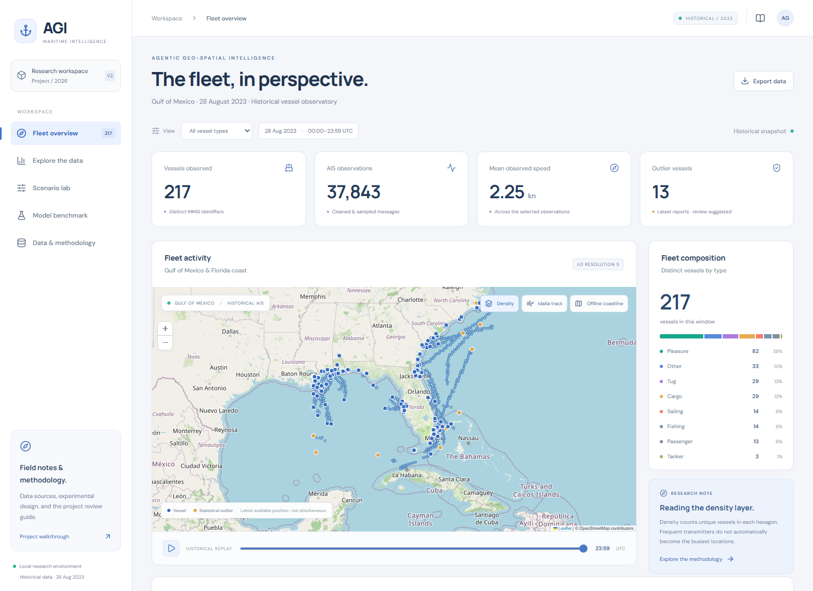
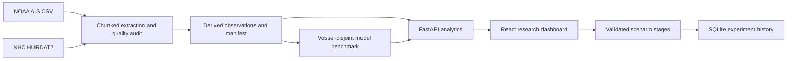

# Agentic Geo-Spatial Intelligence

A local-first maritime research workspace: explore historical vessel movements, audit AIS data, compare speed forecasts, and investigate transparent voyage scenarios.



**Real evidence:** 9,306,345 source messages → 37,843 cleaned observations → 217 distinct vessels. **Honest evaluation:** five approaches, 51 held-out vessels, zero vessel overlap. **No API keys required.**

## Run on this computer

From this folder, run `./start.ps1` in PowerShell, then open http://127.0.0.1:8080. The script builds the frontend if necessary and starts a single local server. Stop with Ctrl+C.

The existing `.runtime` environment is configured and tested. On a different machine, install Python 3.12+ and Node 22+, then run:

```powershell
py -3.12 -m venv .runtime
./.runtime/Scripts/python.exe -m pip install -r requirements.txt
./.runtime/Scripts/python.exe scripts/train_benchmark.py
cd frontend
npm ci
npm run build
cd ..
./.runtime/Scripts/python.exe -m uvicorn backend.main:app --host 127.0.0.1 --port 8080
```

Linux/macOS: use `python3 -m venv .runtime` and `.runtime/bin/python` in place of the Windows executable. A compact derived dataset is included; the 998 MB raw file is not required to run the application or reproduce the model benchmark.

## What works

- **Fleet overview:** offline Natural Earth coastline, optional OpenStreetMap tiles, actual H3 cells, cumulative hourly replay, vessel-type filters, outlier filtering, search, pagination, CSV export, per-vessel tracks and speed estimates.
- **Exploratory analysis:** hourly activity, speed histogram, fleet composition, storm-distance scatterplot, missingness, correlation matrix, and a traceable cleaning funnel.
- **Scenario lab:** calm/busy/severe presets, independent weather and traffic assumptions, configurable fuel/price/carbon inputs, three alternatives, factor contributions, deterministic agent trace, and SQLite save/load/delete history.
- **Model benchmark:** persistence, training median, ridge, random forest, and gradient boosting; MAE/RMSE/R²; vessel-cluster bootstrap interval; held-out permutation importance; observed-versus-predicted scatter.
- **Review support:** embedded walkthrough, source links, research bibliography, experiment tables, report reference materials, and an executable EDA notebook.

## Scientific scope

The predictive task is **next observed speed, 2–30 minutes ahead**, not delay probability or arrival-time prediction. The snapshot covers 28 August 2023 in a Gulf/Florida bounding box. Records are selected by `MMSI % 13 == 0`; the first valid observation in each vessel's five-minute bin is retained. The cohort is deterministic, not a representative global sample.

The split holds entire vessels out of training. Gradient boosting was specified in advance; the test set is not used to choose hyperparameters. Persistence wins MAE (0.3498 kn vs 0.4878 kn); boosting has slightly lower RMSE (1.4886 vs 1.5182 kn). No claim of universal improvement or statistically significant superiority is made.

Storm proximity uses **retrospective HURDAT2 best-track data** and is excluded from forecast features. Scenario weather is hypothetical. Scenario exposure is a weighted index, not a calibrated probability. The illustrative detour is an assumed alternative, not a navigable route. Isolation Forest flags unusual feature combinations, not verified hazards. The project is educational decision support, not a navigation system.

## Architecture



The stages called agents are deterministic Python workflow steps with visible outputs. The current application does not use an LLM, require Gemini credentials, or control ships. The old `agents/`, `ml_models/`, and root training scripts are retained as historical prototype material and are not used by version 2.

## Reproduce and verify

```powershell
# Optional: requires local data/AIS_2023_08_28.csv and data/hurdat2.txt
./.runtime/Scripts/python.exe scripts/build_dataset.py
# Required after rebuilding the source cohort
./.runtime/Scripts/python.exe scripts/train_benchmark.py
./.runtime/Scripts/python.exe -m pytest -q
cd frontend
npm run lint
npm run build
npm audit
```

Derived data, model configuration, seed, software versions, and dataset SHA-256 are recorded under `data/atlas`. The model file is generated locally and deliberately not committed. Never load model pickle/joblib files from untrusted sources. Rebuilding training artifacts requires restarting the backend to load them.

For development, run the backend on 8080 and `npm run dev` inside `frontend`; Vite proxies `/api` to the backend. API documentation is at http://127.0.0.1:8080/docs. Set `VITE_API_URL` only when intentionally separating frontend and backend origins.

The executed EDA notebook is `notebooks/01_maritime_eda.ipynb`. Install `requirements-notebook.txt` to rerun it in a Jupyter-compatible editor. `scripts/execute_notebook.py` also runs it sequentially and captures text and figure outputs.

## API overview

| Endpoint | Purpose |
|---|---|
| `GET /api/health` | Dataset/model readiness |
| `GET /api/overview?vessel_type=All&hour=23` | Filtered metrics, plots, density, latest available vessel positions |
| `GET /api/vessels?q=&page=1&limit=12&flagged=false` | Search and page through vessels |
| `GET /api/vessels/{mmsi}?hour=23` | Recorded trajectory and next-speed estimate |
| `GET /api/benchmark` | Reproducible experiment results |
| `POST /api/scenarios/evaluate` | Evaluate an unsaved hypothetical scenario |
| `POST /api/scenarios` | Evaluate and persist a scenario |
| `GET /api/scenarios` | Most recent 100 saved experiments |
| `DELETE /api/scenarios/{id}` | Delete a saved experiment |
| `GET /api/export` | Filtered CSV with spreadsheet formula protection |

## Deployment and portfolio

`Dockerfile` builds the frontend, trains the small benchmark, and serves everything on port 8080. `docker build -t maritime-agi .` then `docker run --rm -p 127.0.0.1:8080:8080 maritime-agi`. Container history is ephemeral unless `data/atlas` is mounted appropriately. GitHub Actions verifies backend and frontend on each push/PR.

The app is configured for local use. Public multi-user hosting requires authentication, authorization, rate limiting, and an appropriate persistence service. Publicly share the repository and screenshots; avoid exposing the unauthenticated scenario API as a shared service.

Do not commit `.env`, virtual environments, raw archives, or scenario history. No GitHub password or personal access token is needed in this project. The repository is prepared for a normal authenticated Git push; no remote push has been performed.

## Report and review

See `output/documents`, `docs/REVIEW_GUIDE.md`, `docs/REQUIREMENTS_MAP.md`, and `docs/research`. The supplied report-format PDF explicitly prohibits AI tools. Generated report material is therefore a **reference draft for study and verification**, not a compliant final submission. Write the submitted report yourself or obtain your instructor's permission. Three team-member fields are intentionally blank.

## Attribution

AIS: NOAA/BOEM MarineCadastre; storm history: NOAA NHC HURDAT2. Natural Earth 1:110m land polygons are public domain and bundled for offline context; they are too coarse for navigation. Optional OpenStreetMap tiles follow OSM attribution and require network access. Fonts fall back to system sans-serif offline. Citations and data limitations are available in the app and research notes.

## Separate Vercel and Render deployment

The Vercel frontend uses `VITE_API_URL=https://agentic-geo-spatial-intelligence.onrender.com` at build time. The backend allows the exact production frontend origin `https://agentic-geo-spatial-intelligence.vercel.app` plus local development origins. Set `ALLOWED_ORIGINS` to a comma-separated list to override these origins when using another domain. Browser preflight requests and API responses must both permit the frontend origin.

For a native Render Python service, use `pip install -r requirements.txt && python scripts/train_benchmark.py` as the build command and `python -m uvicorn backend.main:app --host 0.0.0.0 --port $PORT` as the start command, from the repository root. The training step recreates the excluded model artifact; `/api/health` should report both `status: ready` and `model_ready: true`. A Docker deployment already performs training during its build. Redeploy after changing either service configuration.
